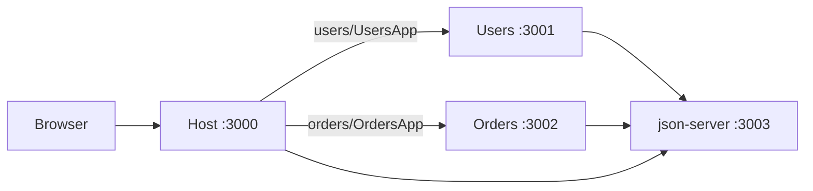

# Micro Frontend Dashboard with Webpack Module Federation

Build **one dashboard product** as **three React apps** plus a **local JSON API**. Each app runs on its own port and can start independently. The host composes the remotes at runtime via Webpack Module Federation.

## What you will learn

- A **host** owns shell, nav, and routing; **remotes** own pages and are loaded at runtime (not npm-installed).
- Each remote also runs **standalone** so teams can develop without the host.
- `react` / `react-dom` are **shared singletons** so you do not load three copies of React.
- UI talks to **json-server** (`db.json`) instead of a real backend.



## Apps and ports

| App | Role | Port | Exposes |
|---|---|---|---|
| [host](host) | Shell: header, sidebar, routes | 3000 | Consumes remotes |
| [users](users) | User list + user detail | 3001 | `UsersApp` |
| [orders](orders) | Order list + simple analytics | 3002 | `OrdersApp` |
| [api](api) | json-server from `db.json` | 3003 | REST: `/users`, `/orders` |

Root [package.json](package.json) uses npm workspaces + `concurrently` so `npm run dev` starts all four.

## Product behavior

- **Host**: layout, nav (Dashboard / Users / Orders), lazy-loads remotes. Dashboard home shows counts from `/users` and `/orders`.
- **Users**: table of users from `/users`; click a row for detail. Standalone at `http://localhost:3001`.
- **Orders**: order table + simple totals (count, revenue, status breakdown) from `/orders`. Standalone at `http://localhost:3002`.

Shared look: same CSS variables / tokens copied into each app (no shared UI library yet — keeps Module Federation the focus).

## Local JSON API

[api/db.json](api/db.json) with seed data, e.g. ~8 users and ~12 orders (`userId` links orders to users). json-server gives:

- `GET http://localhost:3003/users`
- `GET http://localhost:3003/users/:id`
- `GET http://localhost:3003/orders`
- `GET http://localhost:3003/orders?userId=1`

CORS is on by default for local browsers.

## Webpack Module Federation (core)

Each app is Create React App-style **custom webpack** (not CRA eject): `webpack.config.js`, `babel-loader`, `html-webpack-plugin`, `webpack-dev-server`.

**Host** (`host/webpack.config.js`):

```js
new ModuleFederationPlugin({
  name: 'host',
  remotes: {
    users: 'users@http://localhost:3001/remoteEntry.js',
    orders: 'orders@http://localhost:3002/remoteEntry.js',
  },
  shared: {
    react: { singleton: true, requiredVersion: '18.2.0' },
    'react-dom': { singleton: true, requiredVersion: '18.2.0' },
    'react-router-dom': { singleton: true },
  },
})
```

**Users / Orders** remotes expose `./UsersApp` or `./OrdersApp` via `./src/bootstrap.js` (required MF pattern: `index.js` dynamically imports `bootstrap.js` so shared modules initialize first).

Host routes:

- `/` — dashboard summary
- `/users` — `React.lazy(() => import('users/UsersApp'))`
- `/orders` — `React.lazy(() => import('orders/OrdersApp'))`

Error boundary + loading fallback around each remote so a down remote does not crash the shell.

## Folder layout

```
ModuleFederation/
  package.json          # workspaces + "dev" script
  README.md             # how to run + what MF is doing
  api/
    package.json
    db.json
  host/
    webpack.config.js
    src/index.js, bootstrap.js, App.jsx, pages/Dashboard.jsx
  users/
    webpack.config.js
    src/index.js, bootstrap.js, UsersApp.jsx
  orders/
    webpack.config.js
    src/index.js, bootstrap.js, OrdersApp.jsx
```

## How to run (after implementation)

```bash
npm install
npm run dev
```

Open `http://localhost:3000`. Also open `:3001` and `:3002` to see remotes standalone.

## Out of scope (later, as you asked)

Vite Module Federation and mixed React/Vue remotes. This first pass stays on Webpack + all React so the MF mechanics are clear.
